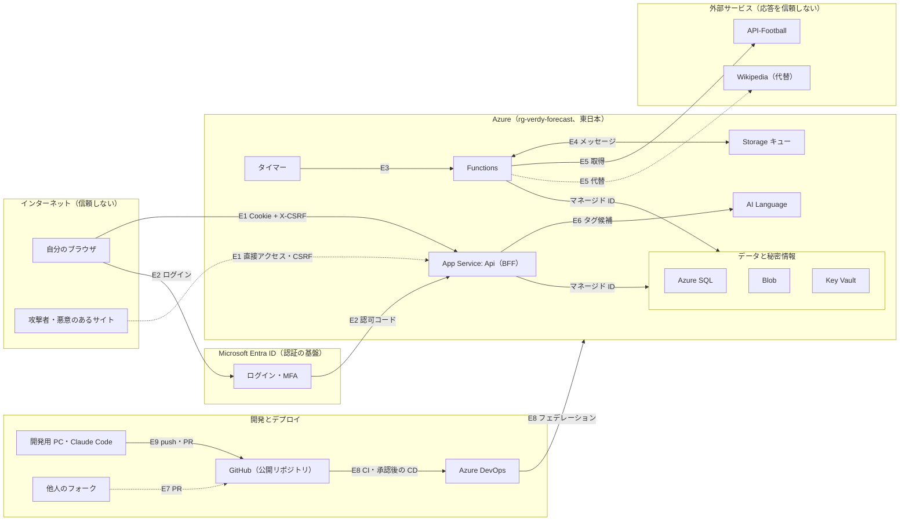

# verdy-forecast 脅威モデル

- 版: 1.0（Claude Code が下書きして、自分が確認した）
- 作成日: 2026-11-23
- 関連: 作業指示書 `docs/work-instructions.md`、評価手順書 `docs/evaluation-procedure.md`、全体図 `docs/project-overview.html`、スキルの `security.md`（OWASP Top 10:2025 の実装ルール）

## 1. この文書について

- 設計の段階で、このアプリで起こりうる脅威を洗い出して、対策とテストを1対1で対応させる（security.md の A06）。
- 脅威の分類には STRIDE を使う。

| 記号 | 分類 | 意味 |
|---|---|---|
| S | なりすまし | ほかの人や、ほかのものになりすます |
| T | 改ざん | データやコードを書き換える |
| R | 否認 | 誰がいつ何をしたか、後から説明できない |
| I | 情報漏えい | 見せてはいけない情報が見える |
| D | サービス拒否 | 使えなくする。費用や無料枠を使い切らせる |
| E | 権限昇格 | 本来できないことができるようになる |

- 使い方
  - ステップを実装したら、そのステップの脅威の「状態」を更新する。
  - 入口、外部サービス、Azure のリソースを足したり変えたりしたら、同じ PR でこの文書も更新する。
  - 評価手順書の A06（脅威モデルの見直し）で、すべての脅威に対策とテストが対応しているかを確認する。

## 2. 範囲と前提

- 対象は v1（作業指示書の4章）。v2 と v3 の機能は、足すときに見直す。
- 使う人は自分1人。インターネットに公開するが、ログインできるのは Entra ID の自分専用のユーザーだけで、MFA は必須。
- リポジトリは公開する。設計とコードは攻撃者に読まれる前提で考える（秘密をコードに頼らない）。
- 予算の上限は月1,000円。「費用や無料枠を使い切らせる」ことも脅威として扱う。
- Azure の構成は、全体図の「実行時の構成」のとおり（まだデプロイしていない）。

### 想定する攻撃者と、ミスの元

| 相手 | できること |
|---|---|
| インターネット上の誰でも | 公開 URL へのアクセス、公開リポジトリを読む、フォークから PR を出す |
| 悪意のあるサイト | ログイン中の自分のブラウザに、リクエストを送らせる。画面を iframe に埋め込む |
| 外部データの提供元 | API-Football や Wikipedia の応答に、壊れたデータや間違ったデータが混ざる |
| 部品の提供元 | NuGet や npm のパッケージ、パイプラインのタスクに、悪意のあるコードや脆弱性が混ざる |
| 自分のミス | 秘密情報のコミット、設定のミス、キックオフ後の予想の書き換え（学習データを汚す） |

## 3. 守るもの

| ID | 守るもの | 何が起きると困るか | 主な置き場所 |
|---|---|---|---|
| A1 | 自分の記録（試合前の予想、採点、タグ、メモ） | 読まれる（メモは私的な内容）。書き換えられる。消える | Azure SQL |
| A2 | 学習データの正しさ | 後出しの予想や、未来のデータが混ざる。モデルと自分の答え合わせが意味を持たなくなる | Azure SQL、Blob（原本、スナップショット） |
| A3 | ログイン（自分のアカウントとセッション） | なりすまされて、A1 を読み書きされる | Entra ID、セッションの Cookie |
| A4 | Azure の費用と無料枠 | 月1,000円を超える。無料枠を使い切ってアプリが止まる | Azure のサブスクリプション |
| A5 | 秘密情報 | API キーが漏れて、無料枠を使われる | Key Vault、ローカルの `dotnet user-secrets` |
| A6 | デプロイの経路 | 悪意のあるコードが本番に入る。Azure にリソースを作られる | GitHub、Azure DevOps、サービス接続 |

A1〜A4 は作業指示書で決めた「守るもの」。A5 と A6 は、A1〜A4 を守るために必要なもの。

## 4. 入口と信頼の境界

### 入口

| ID | 入口 | 誰が届くか | 主な守り |
|---|---|---|---|
| E1 | 画面と API（`/api`、`/bff`、静的ファイル） | インターネットの誰でも | 認証必須、`X-CSRF` ヘッダー、レート制限、セキュリティヘッダー |
| E2 | ログインの戻り（OpenID Connect のコールバック） | インターネットの誰でも | OpenID Connect の検証（state、nonce）、割り当てたユーザーだけ |
| E3 | タイマー | Azure の中だけ | 間隔の制限（D14） |
| E4 | キューのメッセージ | キューに権限のあるマネージド ID だけ | ID と種類だけを入れる。冪等に処理する |
| E5 | 外部 API の応答（API-Football、Wikipedia） | 提供元 | 許可リストのホストだけ。形式の検証。原本と SHA-256 の保存 |
| E6 | AI Language の応答 | Azure のサービス | マスタにあるタグだけを採用する |
| E7 | GitHub（PR、フォーク、Dependabot） | 誰でも PR を出せる | main のルールセット、フォークの PR の制限 |
| E8 | パイプライン（CI と CD） | 自分の承認 | Environments の承認、ワークロード ID フェデレーション |
| E9 | 開発用 PC | 自分 | Claude Code の権限ルール、Azure CLI は使ったらログアウト |

### 信頼の境界

| ID | 境界 | 越えるときの守り |
|---|---|---|
| B1 | インターネット → App Service | 認証、CSRF 対策、レート制限、入力の検証 |
| B2 | Azure → 外部サービス | 呼び出し先は許可リストだけ。応答は信頼せず、検証してから取り込む |
| B3 | アプリ → データと秘密情報 | マネージド ID と最小限の権限。接続文字列とパスワードを使わない |
| B4 | 開発とデプロイ → Azure | PR 必須、承認、ワークロード ID フェデレーション。Claude Code は Azure を操作しない |
| B5 | キックオフ時刻（時間の境界） | キックオフより後に分かった情報は、その試合の自分の予想とモデルの予測の材料にしない |

## 5. 脅威と対策

- 「対策」は security.md の節（A01〜A10）の実装ルール、「テスト・確認」はそれを確かめる方法。
- 「（追加の提案）」は、testing.md や評価手順書にまだ書かれていないテストや確認（7章）。
- 状態: 未実装 / 一部実装済み / 実装済み / 確認待ち（自分の作業の結果待ち）

### 5.1 ログインとセッション

| ID | 入口 | 分類 | 脅威 | 対策 | テスト・確認 | ステップ | 状態 |
|---|---|---|---|---|---|---|---|
| T01 | E1 | S | ログインしていない人が API を呼んで、記録を読み書きする | 何も指定しなければ認証必須（FallbackPolicy）。匿名はヘルスチェックとログインの開始だけ。未ログインは 401（A01） | API 結合テスト: 未ログインで `/api` を呼ぶと 401 | 5-3、5-5 | 未実装 |
| T02 | E2 | S、E | 自分以外の Entra ID のユーザー（ほかのテナントや、同じテナントのほかのユーザー）がログインする | シングルテナント。エンタープライズアプリケーションで「割り当てが必要」をオンにして、自分専用のユーザーだけを割り当てる（A01） | 自分: 割り当てていないユーザーでログインして、拒否される（追加の提案） | 5-2、9-1 | 未実装 |
| T03 | E2 | S | パスワードを盗まれて、なりすまされる | MFA 必須（セキュリティの既定値群）。アプリはパスワードを持たない（A07） | 自分: Entra のサインインログで、毎回 MFA が使われている（評価手順書 A07） | 0-5、9-1 | 確認待ち |
| T04 | E1 | S、I | セッションの Cookie を盗まれる。ログアウトしても、そのセッションが使える | Cookie は `__Host-`、`Secure`、`HttpOnly`、`SameSite`。HTTPS と HSTS。トークンはブラウザに渡さない（BFF）。ログアウトで Cookie を消して、Entra からもサインアウトする（A04、A07） | API 結合テスト: Cookie の名前と属性。ログアウト後に API を呼ぶと 401。自分: localStorage と sessionStorage にトークンがない | 5-3 | 未実装 |
| T05 | E1 | E | テスト用の偽ログインが本番で有効になり、誰でもログインできる | 偽ログインは `Testing` 環境だけ。それ以外の環境で有効なら、起動時に例外を出して止める（A02） | API 結合テスト: `Testing` 以外で有効にすると、起動に失敗する | 5-6 | 未実装 |

### 5.2 画面と API

| ID | 入口 | 分類 | 脅威 | 対策 | テスト・確認 | ステップ | 状態 |
|---|---|---|---|---|---|---|---|
| T06 | E1 | T | 悪意のあるサイトが、ログイン中のブラウザに書き込みのリクエストを送らせる（CSRF）。画面を iframe に埋め込んで、クリックさせる | `/api` への書き込みは `X-CSRF: 1` ヘッダー必須。CORS は設定しない。Cookie の `SameSite`。CSP の `frame-ancestors 'none'`（A01、A02、A07） | API 結合テスト: `X-CSRF` のない POST は拒否される。応答にセキュリティヘッダーが付いている | 5-4 | 未実装 |
| T07 | E1 | T、E | メモなどに入れた文字列が、スクリプトとして動く（XSS） | `dangerouslySetInnerHTML` を使わない。CSP でインラインのスクリプトを禁止する（A05） | Vitest: メモをテキストとして表示する。自分: 評価手順書 A05 の XSS の確認 | 6-3、6-4 | 未実装 |
| T08 | E1 | T | SQL インジェクションで、データを読み書きされる | EF Core の LINQ を使う。`FromSqlRaw` に文字列連結を使わない（A05） | CodeQL。`FromSqlRaw` の使用箇所の検索（評価手順書 A05） | 4-1 | 未実装 |
| T09 | E1 | T | 範囲外の採点、長すぎるメモ、存在しないタグなどで、データを壊す | API の入口とアプリケーション層の両方で検証する（A05、要決定 D6、D10）。Domain の値オブジェクトも、作るときに検証して不正な値を作れないようにする | 単体テストと API 結合テスト: 範囲外の値は 400 で、保存されない | 2-2、3-3、5-5 | 一部実装済み（2-2 で Domain の値オブジェクトの検証。入口の検証は 3-3、5-5） |
| T10 | E1 | T | キックオフ後に、試合前の予想を書き換える・消す（後出し。自分のミスも含む） | サーバー側で、`TimeProvider` の時刻を使って判定して、409 で拒否する（A01）。延期中と終了後もロックする。評価に使う確率は、保存のたびに出どころと一緒に保存する。キックオフ以降は変更できないので、あとでルールを変えても過去の評価は変わらない（作業指示書 D8） | Domain の単体テスト: キックオフの1秒前・ちょうど・1秒後（作る・変える・消すのそれぞれ）、延期、終了。API 結合テスト: ロック後は 409 で拒否されて、DB の値が変わらない。Domain と Application が時刻を直接読まないことは SystemClockTests で確かめている | 2-3、5-5 | 一部実装済み（2-3 で Domain のロック。API の 409 は 5-5） |
| T11 | E1 | I | 自分の予想を入れる前に、モデルの予想を見てしまう（自分の予想がモデルに引きずられて、答え合わせの意味がなくなる） | API は、その試合の自分の予想が登録済みのときだけ、モデルの予想を返す。画面で隠すだけにしない（追加の提案） | API 結合テスト: 自分の予想がないと、モデルの予想が返らない（追加の提案） | 5-5、6-3 | 未実装 |
| T12 | E1 | I | エラーの応答から、内部の情報（スタックトレース、SQL、ファイルのパス）が漏れる | 共通の例外ハンドラーで ProblemDetails にする。本番では開発者向けの例外ページと OpenAPI の画面を出さない（A02、A10） | API 結合テスト: エラーの応答にスタックトレースや例外のメッセージがない。ZAP のベースラインスキャン | 5-4、5-5 | 未実装 |
| T13 | E1 | D | 大量のリクエストで、App Service F1 の CPU の枠や、SQL の無料枠を使い切らせる | 書き込み系にレート制限（429）。未ログインのリクエストは、DB に触れずに 401 で返す（A06） | API 結合テスト: 短い時間に大量に呼ぶと 429 | 5-4 | 未実装 |
| T14 | E1 | R | 予想や採点を「いつ変えたか」が分からず、学習データが正しいか後から説明できない | 予想、採点、レビューの変更を監査ログに残す。メモの本文は入れない（A08） | 単体テストか結合テスト: 変更すると監査ログが1件増えて、メモの本文が入っていない（追加の提案） | 3-2、4-1 | 未実装 |

### 5.3 外部データと AI

| ID | 入口 | 分類 | 脅威 | 対策 | テスト・確認 | ステップ | 状態 |
|---|---|---|---|---|---|---|---|
| T15 | E5 | T | 外部 API の応答が壊れている、または間違っている（提供元の不具合、改ざん） | HTTPS。取り込む前に形式（必須項目、型、範囲）を検証して、おかしいものは取り込まずにログに残す。原本を Blob に保存して SHA-256 を記録する（A08） | Infrastructure 結合テスト: 作り物の壊れた JSON を取り込まない。原本とハッシュが保存される | 4-2、4-3 | 未実装 |
| T16 | E5 | E、I | 外部データやユーザーの入力から URL を組み立てさせて、内部のリソースにアクセスさせる（SSRF） | 呼び出し先は、設定に書いたベース URL（許可リスト）だけ。許可リストにないホストが設定されていたら、起動時にエラーにする（A01） | 単体テスト: 許可リストにないホストを設定すると起動に失敗する（追加の提案） | 4-3 | 未実装 |
| T17 | E3、E5 | D | API-Football の1日100回や、Functions と Storage の無料枠を使い切る（バグ、リトライの暴走、タイマーの間隔） | 呼び出し回数を数えて、上限の手前で止める。リトライは回数と間隔を決める。タイマーの間隔は D14 で決めて、試合のない日は外部を呼ばない（A06） | 単体テスト: 上限に達すると呼び出しを止める（追加の提案）。自分: データの状況の画面（S7）と Azure の使用状況 | 4-3、7-2 | 未実装 |
| T18 | E5 | D | 外部 API が止まっていて、画面が使えなくなる | タイムアウトとリトライ。前回のデータで表示して、「データが古い」と知らせる（A10） | Infrastructure 結合テスト: つながらない状態でも、前回のデータが使われてエラーで落ちない | 4-3、6-3 | 未実装 |
| T19 | E5 | T | 予測の材料に、キックオフより後の情報（その試合の結果や採点）が混ざる（データリーケージ） | 予測の材料は「キックオフ時点で分かっていたデータ」だけで作る（信頼の境界 B5）。期待得点の係数を推定し直すのはシーズンの区切りだけで、前のシーズンまでのデータだけを使う（作業指示書 D5） | データリーケージのテスト（testing.md） | 2-6、2-8 | 未実装 |
| T20 | E6 | T | AI Language の候補に、マスタにないタグや、想定外の文字列が入る | AI の応答は信用しない入力として扱って、マスタにあるタグだけを採用する。AI が使えないときは候補なしで動く（A05） | 単体テスト: マスタにない候補は捨てられる | 4-4 | 未実装 |

### 5.4 試合後の処理

| ID | 入口 | 分類 | 脅威 | 対策 | テスト・確認 | ステップ | 状態 |
|---|---|---|---|---|---|---|---|
| T21 | E4 | T | 同じメッセージが2回届いたり、処理が途中で失敗したりして、計算が二重になる・中途半端な状態が残る | 処理済みの `messageId` を記録して、記録済みなら何もしない。SQL への書き込みはトランザクションでまとめる（A10） | Functions 結合テスト: 同じメッセージを2回送っても計算は1回分。わざと失敗させても、中途半端な状態が残らない | 7-3、7-4 | 未実装 |
| T22 | E4 | D、R | 失敗し続けるメッセージに気づかず、データが更新されないままになる | リトライのあとポイズンキューに移して、ログとアラートを出す。例外を握りつぶさない（A09、A10） | Functions 結合テスト: 失敗し続けるとポイズンキューに移る。自分: アラートが届く | 7-4、9-2 | 未実装 |
| T23 | E4 | I | キューのメッセージから、個人のデータが漏れる | メッセージには ID と種類だけを入れる | 単体テスト: メッセージの型に、ID、種類、日時以外の項目がない（追加の提案） | 7-2 | 未実装 |

### 5.5 データと Azure の設定

| ID | 入口 | 分類 | 脅威 | 対策 | テスト・確認 | ステップ | 状態 |
|---|---|---|---|---|---|---|---|
| T24 | B3 | I | Blob や SQL が、設定のミスでインターネットに公開される | Blob の匿名アクセスと共有キーを無効にする。SQL は Entra ID 認証だけ。TLS 1.2 以上（A02） | PSRule for Azure。Defender for Cloud。評価手順書の7章 | 8-1、8-2 | 未実装 |
| T25 | B3 | E | アプリのマネージド ID に必要以上の権限があり、乗っ取られたときの被害が広がる | API と Functions は読み取りと書き込みだけ。パイプラインはマイグレーションに必要な権限だけ（作業指示書 8-7） | 自分: 付けた権限を確認する（評価手順書の7章） | 8-7 | 未実装 |
| T26 | B1、B3 | I | ログに、Cookie、トークン、API キー、メモの本文が残る | ログに残さないものを決めて、構造化ログで出す（A09） | 結合テスト: ログの出力に、メモの本文や Cookie が含まれない（追加の提案） | 5-4、9-2 | 未実装 |

### 5.6 秘密情報と費用

| ID | 入口 | 分類 | 脅威 | 対策 | テスト・確認 | ステップ | 状態 |
|---|---|---|---|---|---|---|---|
| T27 | E7、E9 | I | API キーや接続文字列を、公開リポジトリにコミットしてしまう | ローカルは `dotnet user-secrets`、Azure は Key Vault とマネージド ID（接続文字列を持たない）。`.gitignore`。GitHub のシークレットスキャンとプッシュ保護（A04） | GitHub のシークレットスキャンのアラートが0件（評価手順書 A04） | 0-6、1-3 | 一部実装済み（`.gitignore`。プッシュ保護は 0-6 の結果待ち） |
| T28 | — | D | 有料のリソースや設定のミスで、月1,000円を超える | 予算アラート（50%、80%、100%）。azure-cost.md の許可リスト。what-if を見てから承認。Log Analytics の1日の取り込み上限 | 自分: Cost Management で確認する（9-5）。what-if に許可リストにないリソースが出ない | 0-1、8-1、8-5 | 確認待ち |

### 5.7 開発とデプロイ

| ID | 入口 | 分類 | 脅威 | 対策 | テスト・確認 | ステップ | 状態 |
|---|---|---|---|---|---|---|---|
| T29 | E7、E8 | T、E | フォークからの PR でパイプラインを動かして、シークレットやサービス接続を悪用する | フォークからの PR はビルドしない（Azure DevOps の組織・プロジェクトの設定）。CD は main だけで動かす（A03） | 自分: 「Disable building pull requests from forked repositories」が選ばれている（評価手順書 A03） | 1-7、8-3 | 一部実装済み（フォークの PR の設定は 1-7 で確認済み。CD は 8-3） |
| T30 | E7 | T | 悪意のあるパッケージや、脆弱性のあるパッケージが入る | セントラルパッケージ管理とロックファイル。CI は `--locked-mode`。`nuget.config` で取得元を nuget.org だけにする。NuGetAudit をエラーとして扱う。Dependabot（公開から7日たっていない版は提案しない）。入れる前にライセンスを確認する。SBOM（A03） | CI の locked-mode と NuGetAudit。評価手順書 A03。1-6 で、脆弱性のあるパッケージを入れると restore が NU1903 で失敗することを確認した | 1-3、1-6、8-10 | 一部実装済み（1-3 の設定、1-6 の CI の定義と Dependabot、1-7 でパイプラインを登録。SBOM は 8-10） |
| T31 | E7、E8 | E | main に直接 push したり、承認なしで本番にデプロイしたりする | main のルールセットで PR を必須にする。Environments の承認。ワークロード ID フェデレーション（シークレットを置かない）。サービス接続の権限はリソースグループだけ（A08） | 自分: main に直接 push できない（1-1）。評価手順書 A08 | 1-1、8-4 | 一部実装済み（1-1 のルールセット） |
| T32 | E9 | E | 開発用 PC の Claude Code が Azure を操作したり、秘密情報を読んだりする | `.claude/settings.json` で `az` などのコマンドと、`~/.azure` と user-secrets の読み取りを禁止する。Azure CLI は使ったらすぐログアウトする | 自分: `/permissions` でルールが読み込まれている（0-10） | 0-10 | 一部実装済み（設定ファイルはある。`/permissions` での確認は自分） |

## 6. 受け入れるリスク

対策をしても残る、または対策しないと決めたリスク。

| ID | リスク | 受け入れる理由 | 和らげる工夫 |
|---|---|---|---|
| R1 | フィッシングや、MFA の通知を何度も送る攻撃で、自分のアカウントが乗っ取られる | 条件付きアクセスなどの追加の守りは、有料のライセンス（Entra ID P1）が必要 | MFA 必須。Authenticator の番号の一致。サインインログを確認する |
| R2 | 開発用 PC が侵害される（Smart App Control をオフにしたことを含む） | 開発に必要（オンのままだとテストが実行できない。作業指示書の付録 A） | Defender のウイルス対策と評価ベースの保護はオンのまま。本番の秘密情報は PC に置かない（Key Vault とフェデレーション）。ローカル用のシークレットは有効期限を短くする。Azure CLI は使ったらログアウト |
| R3 | 代替の取得元（Wikipedia）の荒らしで、間違った試合結果を取り込む | 代替の取得元で、使う頻度は低い | 形式と範囲の検証。原本と SHA-256 を残して、後から追跡できるようにする |
| R4 | タグの候補を作るために、メモとスタッツを AI Language に送る | 候補を作るのに必要。送り先は自分の Azure のリソース | ログにメモを残さない。AI が使えなくても、候補なしで動く |
| R5 | 公開リポジトリなので、設計とコードを攻撃者が読める | 決定事項（作業指示書の2章） | 秘密をコードに頼らない設計にする。シークレットスキャンとプッシュ保護 |
| R6 | App Service F1 は無料枠の CPU 時間を超えると止まり、SLA もない | 予算のため | レート制限（T13）。止まっても記録は SQL に残る |

## 7. testing.md と評価手順書への追加の提案

表の「（追加の提案）」をまとめたもの。入れるかどうかは自分が決める。

| 脅威 | 追加するテストや確認 | 追加先 |
|---|---|---|
| T02 | 割り当てていないユーザーでログインすると拒否される | 評価手順書（A01） |
| T11 | 自分の予想がないと、API がモデルの予想を返さない | testing.md のセキュリティのテスト |
| T14 | 変更すると監査ログが残り、メモの本文が入っていない | testing.md |
| T16 | 許可リストにないホストを設定すると、起動に失敗する | testing.md のセキュリティのテスト |
| T17 | API-Football の呼び出しが上限に達すると止まる | testing.md |
| T23 | キューのメッセージに、ID、種類、日時以外の項目がない | testing.md |
| T26 | ログに、メモの本文や Cookie が出ない | testing.md のセキュリティのテスト |

## 8. 見直すタイミング

- Phase が終わったとき（評価手順書の「Phase が終わったとき」の確認と一緒に）
- 入口、外部サービス、Azure のリソースを足したり変えたりしたとき（同じ PR で更新する）
- 要決定（D1〜D14）が決まったとき。例: D2 で Container Apps に切り替えたら、Data Protection のキーの置き場所（security.md の A04）が変わる
- リリースの前（9-4）。すべての脅威に、対策とテストが対応していることを確認する

## 変更履歴

| 日付 | 内容 |
|---|---|
| 2026-11-23 | 初版の下書き（作業指示書 1-5） |
| 2026-11-23 | 自分が確認（修正なし）。T11 と7章の提案は、該当するステップで採用するかを決める |
| 2026-11-23 | 1-6: T30 の対策と状態を更新（CI の定義、Dependabot、NuGetAudit の確認） |
| 2026-11-23 | 1-7: T29 の対策を「フォークからの PR はビルドしない」に変更（Azure DevOps の設定に合わせた。作業指示書の当初の案より厳しい）。T30 の状態を更新（パイプラインを登録） |
| 2026-11-24 | 2-1: 要決定 D5、D8 の決定に合わせて、T10 と T19 の対策を追加 |
| 2026-11-24 | 2-2: T09 の状態を更新（Domain の値オブジェクトの検証） |
| 2026-11-25 | 2-3: T10 の対策と状態を更新（Domain のロック。延期中と終了後もロック。評価に使う確率は保存のたびに持つ） |
